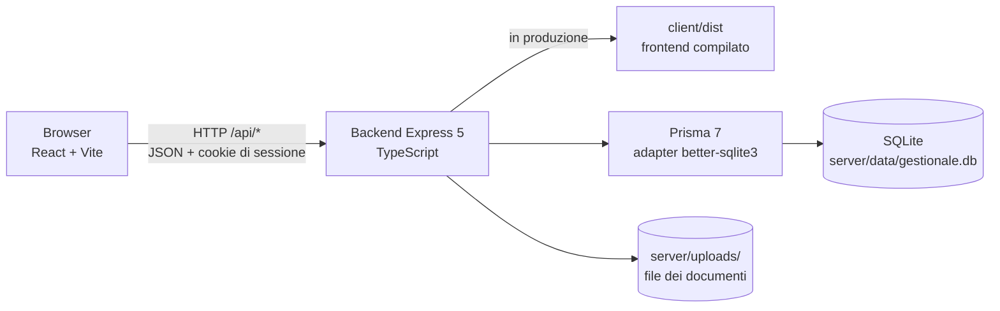
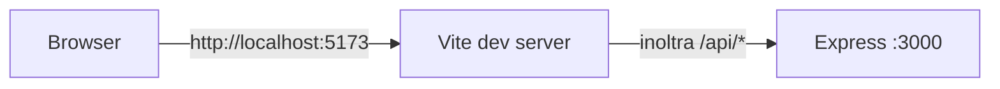
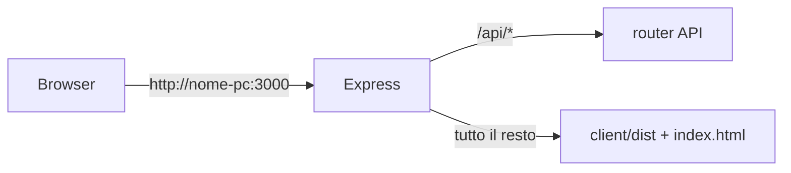
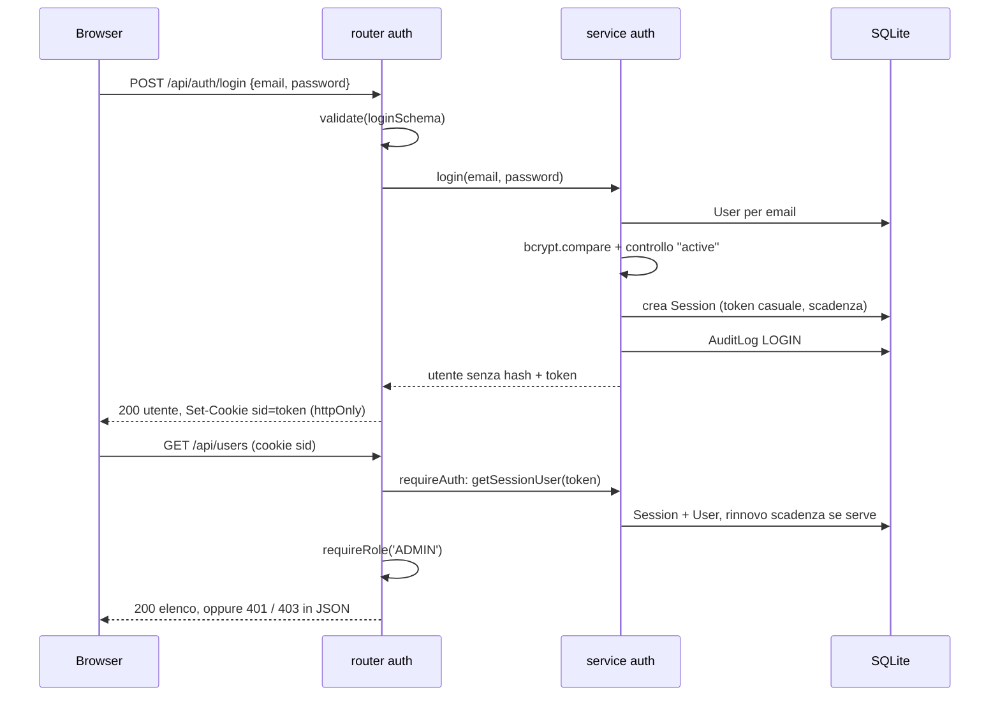

# Architettura

Questo documento descrive come sono collegati i componenti del gestionale e cosa succede a una richiesta dal browser fino al database e ritorno. Si aggiorna a ogni fase: le parti segnate "in arrivo" non esistono ancora nel codice.

## Componenti

- **Frontend** (`client/`): applicazione React che gira nel browser. Non parla mai direttamente con il database o con i file: chiede tutto al backend tramite `client/src/api/client.ts`.
- **Backend** (`server/`): applicazione Express. Espone le API sotto `/api/*`, controlla login e ruolo su ogni rotta riservata, legge e scrive il database e i file. In produzione serve anche il frontend compilato.
- **Database**: un unico file SQLite, usato tramite Prisma. Tabelle e regole in [DATABASE.md](DATABASE.md).
- **Cartella dei documenti**: sul disco, non raggiungibile dal browser. Nel database stanno solo i metadati; i file si scaricano solo passando dal backend (endpoint in arrivo con la fase 5). Oggi la cartella viene riempita dal seed con i documenti di esempio.

## Sviluppo e produzione

In **sviluppo** girano due processi, avviati insieme da `npm run dev`:

Vite serve il frontend con ricarica automatica e inoltra le chiamate `/api` al backend (configurato in `client/vite.config.ts`). Così nel codice del frontend non ci sono mai indirizzi o porte.

In **produzione** gira un processo solo (`npm start`):

`server/src/app.ts` controlla se esiste `client/dist`: se c'è, serve i file statici e rimanda `index.html` per qualsiasi percorso non-API (le pagine come `/utenti` le gestisce React nel browser).

## Backend: come è organizzato

Il backend è diviso per funzionalità, non per tipo di file. Ogni funzionalità è una cartella in `server/src/` con al massimo tre file (più `middleware.ts` per `auth`):

| File         | Compito                                                           |
| ------------ | ----------------------------------------------------------------- |
| `router.ts`  | Definisce gli endpoint, valida l'input con zod, chiama il service |
| `service.ts` | Contiene la logica e l'accesso al database                        |
| `schemas.ts` | Gli schemi zod dell'input (usati dal router)                      |

Moduli presenti: `auth/` (accesso, sessioni, permessi), `users/` (gestione utenti), `audit/` (registro attività, solo scrittura per ora). In arrivo: `clients/`, `practices/`, `documents/`, `search/`.

File comuni:

| File                     | Compito                                                                                                 |
| ------------------------ | ------------------------------------------------------------------------------------------------------- |
| `src/index.ts`           | Avvio: crea l'app e la mette in ascolto sulla porta configurata                                         |
| `src/app.ts`             | Crea l'app Express: helmet, JSON, cookie, router dei moduli, 404 JSON, frontend statico, gestore errori |
| `src/config.ts`          | Legge e valida le variabili d'ambiente con zod; calcola i percorsi assoluti di database e uploads       |
| `src/db.ts`              | L'unica istanza di Prisma, collegata a SQLite tramite l'adapter; imposta la modalità WAL                |
| `src/lists.ts`           | Le liste fisse: ruoli, tipi pratica, stati, tipi documento                                              |
| `src/shared/errors.ts`   | `HttpError` e il gestore centrale degli errori: risponde sempre in JSON                                 |
| `src/shared/validate.ts` | `validate(schema, dati)` e `parseId`: input controllato o risposta 400 con messaggi in italiano         |
| `src/generated/prisma/`  | Client Prisma generato dallo schema (non si modifica, non va su git)                                    |
| `prisma/schema.prisma`   | Lo schema del database                                                                                  |
| `prisma/migrations/`     | Le migrazioni SQL, una cartella per modifica dello schema                                               |
| `prisma/seed.ts`         | I dati di esempio (con i file in `prisma/seed-files/`)                                                  |

Separare `createApp()` (in `app.ts`) da `listen()` (in `index.ts`) permette ai test di usare l'app senza aprire una porta.

## Dove stanno i dati

| Cosa               | Dove                          | Impostato da                    |
| ------------------ | ----------------------------- | ------------------------------- |
| Database           | `server/data/gestionale.db`   | `DATABASE_URL` in `server/.env` |
| File dei documenti | `server/uploads/<uuid>.<ext>` | `UPLOAD_DIR` in `server/.env`   |
| Database dei test  | `server/tests/.tmp/test.db`   | `server/vitest.config.ts`       |

I percorsi in `.env` sono relativi alla cartella `server/`; `config.ts` li trasforma in assoluti una volta sola, così non dipendono da dove viene lanciato il processo.

## Accesso e permessi

- **Sessione**: riga in `Session` con token casuale e scadenza (`SESSION_HOURS`); il token sta nel cookie `sid`, `httpOnly` e `SameSite=Lax`, senza scadenza nel browser. `requireAuth` carica l'utente in `req.user`; `currentUser(req)` lo restituisce nei router.
- **Ruoli**: `requireRole('ADMIN', 'OPERATOR')` dopo `requireAuth`. Il frontend nasconde le voci di menu non permesse, ma è il backend a decidere: una chiamata diretta senza il ruolo giusto riceve `403`.
- **Chiusura forzata**: reset della password e disattivazione cancellano le sessioni dell'utente; il cambio della propria password chiude le sessioni sugli altri dispositivi.
- **Tentativi**: 5 errori sulla stessa email bloccano il login per 15 minuti (contatore in memoria).

## Percorso di una richiesta

### Esempio: l'Amministratore crea un utente

1. In `UsersPage.tsx` il pulsante "Nuovo utente" apre `Modal` con `UserForm`.
2. All'invio, `UserForm` chiama `api.post<User>('/users', { name, email, role, password })`.
3. `client/src/api/client.ts` fa `fetch('/api/users')` con JSON e cookie di sessione.
4. In sviluppo Vite inoltra la richiesta a Express; in produzione arriva direttamente.
5. `app.ts` passa la richiesta a `usersRouter`, che prima esegue `requireAuth` (sessione valida, utente in `req.user`) e `requireRole('ADMIN')`.
6. Il router valida il corpo con `validate(createUserSchema, req.body)`: se manca qualcosa risponde `400` con i messaggi in italiano.
7. `users/service.ts` controlla che l'email sia libera (`409` altrimenti), calcola l'hash della password, crea la riga `User`, scrive nel registro attività e restituisce l'utente senza hash.
8. Il router risponde `201` con l'utente; `UsersPage` lo inserisce nella tabella senza ricaricarla e mostra "Utente ... creato".
9. In caso di errore, `errorMessage(err)` trasforma l'`ApiError` nel testo mostrato nell'`Alert` del form.

### In arrivo (fase 5): caricamento di un documento

Questo è il percorso previsto; verrà confermato e dettagliato quando il codice esisterà.

1. Il form React invia `multipart/form-data` a `POST /api/practices/:id/documents`.
2. `requireAuth` e `requireRole` come sopra.
3. Multer salva il file in una cartella temporanea controllando dimensione e tipo dichiarato.
4. Il router valida i campi con zod e controlla i primi byte del file (PDF, JPEG, PNG, ZIP per Word/Excel).
5. Il service sposta il file in `server/uploads/<uuid>.<ext>`, crea la riga `Document` nel database e una riga nel registro attività (lo stesso schema che oggi segue il seed).
6. Risposta JSON con il documento; il frontend aggiorna la lista.
7. Se qualcosa fallisce dopo il salvataggio su disco, il file viene rimosso per non lasciare orfani.

## Frontend: come è organizzato

- `main.tsx` monta `BrowserRouter` e `AuthProvider`, poi `App`.
- `App.tsx` elenca le rotte. `/accesso` è pubblica; tutto il resto sta dentro `RequireAuth` (rimanda a `/accesso` senza utente) e dentro `Shell` (barra laterale + contenuto). Le pagine riservate a un ruolo stanno dentro `RequireRole`.
- `AuthContext` chiede `GET /auth/me` all'avvio per sapere chi è già dentro, ed espone `login` e `logout`. Se una chiamata qualsiasi riceve `401`, `api/client.ts` emette un evento e il contesto azzera l'utente: si torna alla pagina di accesso.
- Ogni pagina è autonoma: stato con `useState`, caricamento in `useEffect`, chiamate `api.*`, errori in un `Alert`. Dopo un salvataggio aggiorna la propria lista con l'oggetto restituito dal backend.

## Gestione degli errori

- Nel backend, un errore previsto si lancia con `throw new HttpError(404, 'Utente non trovato')`; `errorHandler` in `shared/errors.ts` lo trasforma in `{ error }` con quello status. Gli errori di validazione diventano `400` con i messaggi degli schemi zod. Tutto il resto è `500` con "Errore interno del server" (il dettaglio va nel log).
- Express 5 passa da solo al gestore gli errori lanciati nelle funzioni `async`: nei router non servono `try/catch`.
- Nel frontend, `ApiError` porta status e messaggio: le pagine lo mostrano all'utente con `errorMessage(err)`, senza interpretarlo.

## Sicurezza

- Password salvate come hash bcrypt (`bcryptjs`, costo 10). Nessuna risposta contiene l'hash.
- Sessione in cookie `httpOnly` e `SameSite=Lax`: il JavaScript nel browser non può leggerla e non parte da siti terzi. `COOKIE_SECURE=true` la limita a HTTPS.
- Ogni rotta riservata dichiara `requireAuth` e, se serve, `requireRole`. Un utente disattivato perde subito l'accesso.
- Header di sicurezza con helmet (senza `upgrade-insecure-requests`, perché in ufficio si usa HTTP in rete locale).
- Limite ai tentativi di login; login che non rivela se un'email esiste.
- In arrivo (fase 5): file scaricabili solo tramite il backend, controllo di tipo e dimensione.
