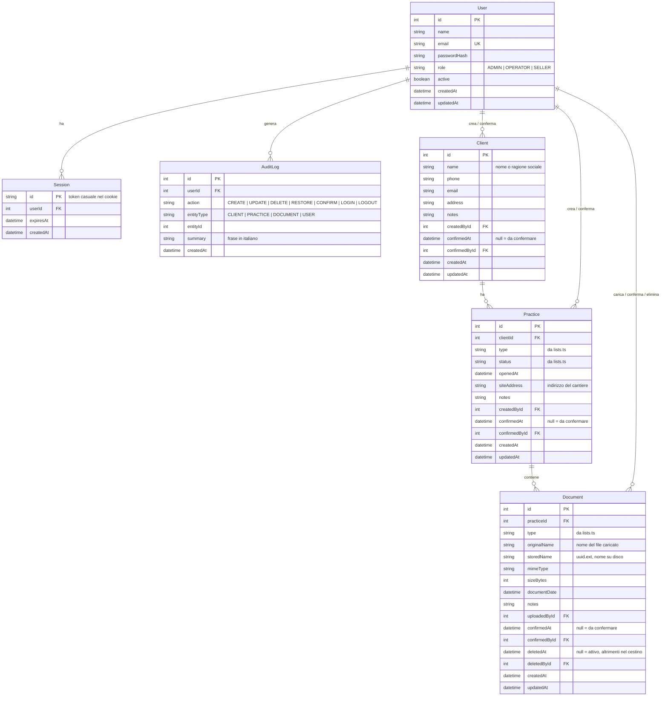

# Database

Il gestionale usa **SQLite**: un unico file, `server/data/gestionale.db`, letto e scritto tramite **Prisma 7**. Per il backup basta copiare quel file insieme alla cartella dei documenti `server/uploads/` (script in arrivo con la fase 8).

## Diagramma

Lo schema completo, con i commenti, è in `server/prisma/schema.prisma`.

## Tabelle

| Tabella    | Cosa rappresenta                                                                                    |
| ---------- | --------------------------------------------------------------------------------------------------- |
| `User`     | Un dipendente che può accedere. `role` decide cosa può fare; `active = false` blocca l'accesso.     |
| `Session`  | Un login attivo. L'`id` è il token casuale salvato nel cookie; scade a `expiresAt`.                 |
| `Client`   | Un cliente, persona o azienda.                                                                      |
| `Practice` | Una pratica di un cliente (preventivo, ordine, installazione, detrazioni fiscali) con il suo stato. |
| `Document` | Un file caricato in una pratica. Nel database ci sono solo i metadati: il file è su disco.          |
| `AuditLog` | Chi ha fatto cosa e quando. `summary` è già la frase da mostrare nel registro attività.             |

## Convenzioni

- **Liste come stringhe.** `role`, `type`, `status`, `action`, `entityType` sono `String`, non enum del database. I valori ammessi stanno in `server/src/lists.ts` e vengono controllati dal codice (zod) prima di scrivere. Cambiare una lista non richiede una migrazione.
- **Testi facoltativi = stringa vuota.** `phone`, `email`, `address`, `notes`, `siteAddress` hanno default `""` invece di `NULL`: i form del frontend lavorano con stringhe e non devono gestire il caso "nullo".
- **"Da confermare".** `Client`, `Practice` e `Document` hanno `confirmedAt` e `confirmedById`. Se `confirmedAt` è `null` il record è stato proposto da un Venditore e aspetta la conferma di un Operatore o Amministratore. I record creati da Operatore e Amministratore nascono già confermati.
- **Cestino.** Un documento con `deletedAt` valorizzato è nel cestino (e `deletedById` dice chi l'ha eliminato). Le liste normali mostrano solo i documenti con `deletedAt = null`. L'eliminazione definitiva cancella la riga e il file.
- **Chi ha fatto cosa.** `createdById`, `uploadedById`, `confirmedById`, `deletedById` puntano a `User`; sono le basi del registro attività e dei permessi "solo i propri record".
- **Id numerici progressivi.** Più leggibili per gli utenti ("pratica n. 42"). I file su disco invece hanno un nome casuale (`storedName`), così non si indovina.
- **Date.** Sono `DateTime` in UTC. Le date "di calendario" (`openedAt`, `documentDate`) si salvano a mezzanotte e si mostrano come giorno.
- **Vincoli.** Non si può cancellare un cliente con pratiche né una pratica con documenti (`onDelete: Restrict`): la regola "si elimina solo se vuoto" è garantita anche dal database. Le sessioni invece spariscono con l'utente (`Cascade`).
- **Indici.** Sulle chiavi esterne usate nelle liste (`clientId`, `practiceId`, `userId`), su `deletedAt` e `documentDate` (filtri della ricerca), su `createdAt` e `(entityType, entityId)` del registro.

## Come si modifica lo schema

1. Modifica `server/prisma/schema.prisma`.
2. Dalla cartella principale: `npm run db:migrate -- --name descrizione-breve`. Prisma crea una cartella in `server/prisma/migrations/` con l'SQL, la applica al database di sviluppo e rigenera il client.
3. Committa la migrazione insieme allo schema. Non modificare a mano i file già creati in `migrations/`.
4. In produzione, dopo l'aggiornamento: `npm run db:deploy` applica le migrazioni mancanti senza fare domande.

## Il client generato

`prisma generate` scrive codice TypeScript in `server/src/generated/prisma/` a partire dallo schema: da lì arrivano `PrismaClient` e i tipi (`User`, `Client`, ...). La cartella è ignorata da git e viene rigenerata da `npm install` (script `postinstall`) e da `npm run build`. Non va modificata a mano.

## La connessione: `server/src/db.ts`

Crea l'unica istanza di `PrismaClient` del backend. Prisma 7 non parla direttamente con SQLite: passa da un "adapter" (`@prisma/adapter-better-sqlite3`) a cui diamo il percorso assoluto del file, calcolato in `config.ts` a partire da `DATABASE_URL` e dalla cartella `server/`. All'avvio imposta la modalità **WAL**, che permette più letture contemporanee e un backup sicuro (`VACUUM INTO`) mentre il gestionale è acceso.

Tutto il resto del backend importa `prisma` da questo file: non si creano altri client.

## Dati di esempio (seed)

`npm run db:seed` esegue `server/prisma/seed.ts` e carica:

- 3 utenti, uno per ruolo, tutti con password `password123`: `admin@esempio.it`, `operatore@esempio.it`, `venditore@esempio.it`;
- 5 clienti (uno proposto dal venditore, da confermare);
- 8 pratiche con tipi e stati diversi (una proposta dal venditore);
- 8 documenti con file PDF e PNG veri copiati da `server/prisma/seed-files/` nella cartella uploads, uno dei quali nel cestino e uno da confermare;
- le righe del registro attività corrispondenti.

Regole di sicurezza: se il database contiene già utenti il seed **non fa nulla**, per non cancellare dati veri per sbaglio. Per svuotare tutto e ricaricare gli esempi: `SEED_RESET=1 npm run db:seed` (in PowerShell: `$env:SEED_RESET='1'; npm run db:seed`). Il reset cancella solo i file dei documenti registrati nel database.

## Il database dei test

I test non toccano `data/gestionale.db`. `server/tests/global-setup.ts` crea `server/tests/.tmp/test.db` applicando le stesse migrazioni della produzione (`prisma migrate deploy`) e una cartella uploads temporanea; `vitest.config.ts` passa questi percorsi al backend tramite `DATABASE_URL` e `UPLOAD_DIR`. Ogni file di test chiama `runSeed({ reset: true })` per partire da dati noti. I file di test girano uno alla volta perché condividono lo stesso database.

## Guardare i dati

`npm run db:studio` avvia Prisma Studio su http://localhost:5555: tabelle, righe e relazioni, con possibilità di modifica. Comodo per controllare cosa ha fatto il codice. Si ferma con Ctrl+C.

Nota: in Prisma 7.10 Studio accetta l'URL del database solo nella forma `file://./...`, mentre le migrazioni accettano solo `file:./...`. In `.env` resta la forma delle migrazioni; `prisma.config.ts` la converte quando il comando è `studio`.
